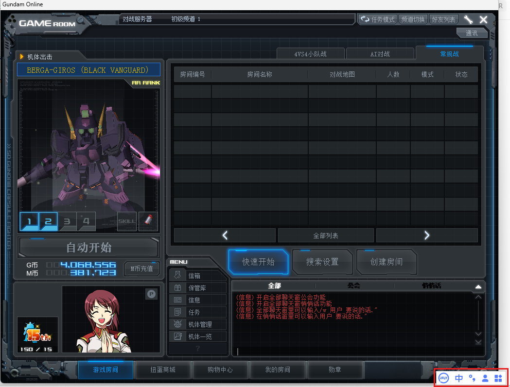
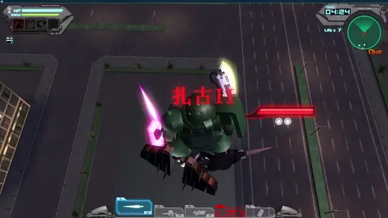
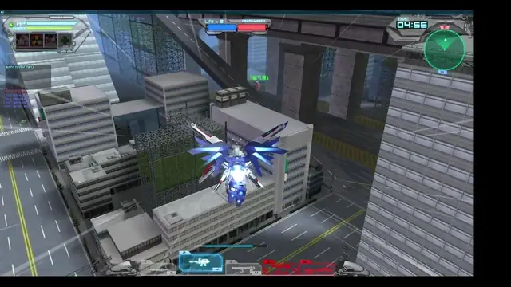

# SDGO mod framework

Core fixes and optional extensions for SD Gundam Online clients and private servers.
All mods share one framework for build verification, loading, configuration and updates.
Unofficial fan project; no game files are included. [简体中文](README.zh-CN.md)

**Start with core fixes, then choose your extensions.** Beta is a release channel, independent of category.

[Install and configure](docs/setup.md) · [Latest release](https://github.com/crabsatellite/SDGO-d3d9-proxy/releases/latest) · [Developer API](docs/framework.md)

## Core fixes

Recommended defaults for startup, input method and compatibility problems.

<!-- mod-category:fixes -->
| Feature | Purpose | Mods / tool | Install on | Guide |
|---|---|---|---|---|
| IME input fix | Correct the length of committed IME text | `ime_fix` | Clients | [Use](docs/ime-fix.md) |
| Input method freeze fix | Restore window lookup needed by input methods alongside existing plugins | `findwindow_fix` | Clients | [Use](docs/findwindow-fix.md) |
| Startup crash fix | Avoid loading screens referencing missing units | `startup_crash_fix` | Clients | [Use](docs/startup-crash-fix.md) |
| Agent relay log fix | Correct native relay logging | `agent_relay_log_fix` | Agent servers | [Use](docs/agent-relay-log-fix.md) |
| Battle rank regression fix | Prevent a higher sublevel from lowering the major rank, such as 15-1 → 5-2 | [SQL repair tool (source)](tools/rank_progression_fix.py) | Game database | [Use](docs/rank-progression-fix.md) |
<!-- /mod-category:fixes -->

The rank repair is applied separately by the server owner from a source checkout, with read-only audit,
backup and rollback support. Players need no client update.

Input method example

## Gameplay extensions

Optional features for a more complete solo or multiplayer game. NPCs, unit pools
and random-unit gameplay belong in this category.

<!-- mod-category:gameplay -->
| Feature | Purpose | Mods | Install on | Guide |
|---|---|---|---|---|
| Mission AI wingmen | Add AI teammates with `!ai` in a mission title | `coop_ai`, `mission_ai` | Battle servers + clients | [Use](docs/coop-wingmen.md) |
| PvP AI (Beta) | AI opponents and teammates with scoring, respawn, decks and spectating | `pvp_ai`, `match_ai` | Battle servers + all participants | [Use](docs/pvp-ai.md) |
| Per-round random loadouts (Beta) | Use `!rand` to randomize each human's owned units every battle; deck modes total exactly ten points. Composes with `!ai`. | `room_random` | Battle server | [Use](docs/room-random.md) |
<!-- /mod-category:gameplay -->

Short AI gameplay examples

Mission wingmen:

PvP AI (Beta); also supports death match, Grid, leader and Tag:

## Networking and hosting

Connections, relays, port mapping and owner deployment tools have their own
category and owner-supplied configuration. They are managed separately from
gameplay. The package's feature directory lists the tools actually included.

<!-- mod-category:network -->
| Feature | Purpose | Mods | Install on | Guide |
|---|---|---|---|---|
| FRP connectivity (Beta) | Owner-configured endpoint mapping and reusable UDP ports | `net_route`, `agent_udp_pool` | Clients + Agent servers | [Use](docs/frp-distribution.md) |
<!-- /mod-category:network -->

## Rule design and previews

The [battle reward policy and calculator](docs/battle-reward-design.md) provide the approved
AI parity, base/event multiplication, compounding 1.1 bonus per extra human, and outcome,
kill, damage, Boss and PvP MVP awards. An assistant preview is available from source.
Native settlement and wallet delivery remain unconnected; this is not a runtime catalog
mod and does not change current game rewards.

## Developer tools

For development and troubleshooting; disabled by default.

<!-- mod-category:development -->
| Tool | Purpose | Mods | Install on | Guide |
|---|---|---|---|---|
| Packet logger | Capture outgoing packets for protocol troubleshooting | `net_probe` | Clients | [Use](docs/net-probe.md) |
<!-- /mod-category:development -->

## Install and use

1. Follow the [installation guide](docs/setup.md#install); multi-host features need their matching server parts.
2. Start with your usual launcher and enable extensions using their guides.
3. Use the installer to update while keeping your configuration. Categories,
   whole features and individual mods have separate switches.

`CONTENTS.md` and `sdgo/catalog.json` describe the features selected for the package.
[Installation, removal and troubleshooting](docs/setup.md) · [Build and add extensions](docs/framework.md#adding-a-feature)

MIT: [LICENSE](LICENSE). Third-party notices: [THIRD_PARTY_NOTICES.md](THIRD_PARTY_NOTICES.md).
